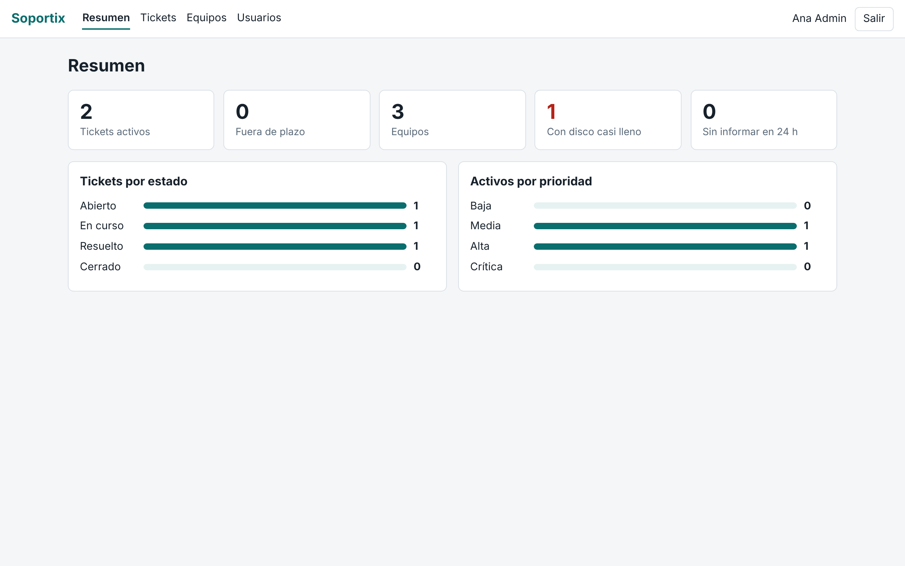
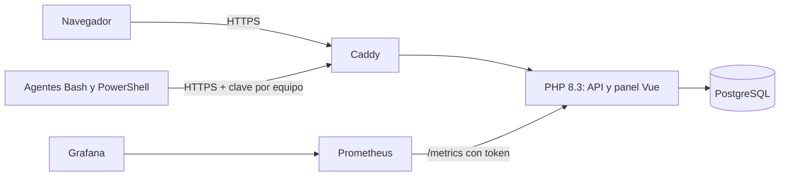

# Soportix

Portal de soporte técnico con inventario automático de equipos. Reúne en un solo proyecto desarrollo web, bases de datos, administración de sistemas, despliegue en la nube y seguridad.



## Qué hace

- **Tickets** con roles (administración, técnico, usuario), prioridades, plazos, asignación y notas internas.
- **Inventario** de hardware y software enviado por agentes en Bash y PowerShell.
- **Alertas automáticas**: si un equipo supera el 90 % de disco se abre un ticket, sin duplicarlo mientras siga activo.
- **Panel** en Vue con búsqueda, filtros, tema claro y oscuro, e historial por equipo.
- **Cuentas**: cambio de contraseña, restablecimiento por administración y registro de actividad.
- **Monitorización** con Prometheus y Grafana, y copias de seguridad con prueba de restauración.

## Arquitectura



| Área | Tecnología |
|---|---|
| Backend | PHP 8.3 con arquitectura propia (enrutador, controladores, PDO) |
| Frontend | Vue 3 y Vite |
| Base de datos | PostgreSQL; SQLite para desarrollo |
| Sistemas | Bash, PowerShell, Prometheus, Grafana |
| Despliegue | Docker Compose, Caddy, GitHub Actions, Terraform en AWS |

## Puesta en marcha en local

Necesitas PHP 8.3 con `pdo_sqlite` y Node 22.

```bash
cd frontend && npm ci && npm run build && cd ../backend
php bin/migrate.php
php bin/seed-demo.php
php -S 127.0.0.1:8080 -t public public/index.php
```

Abre <http://127.0.0.1:8080>. Cuentas de demostración, solo para local: `admin@soportix.test`, `tecnico@soportix.test` y `usuaria@soportix.test`, con la contraseña `demo-soportix-2026`.

## Despliegue con Docker

```bash
cp .env.example .env   # rellena todos los valores
docker compose up -d --build
```

Grafana queda en `127.0.0.1:3000`; accede con un túnel SSH. La infraestructura de AWS está en [`infra/terraform`](infra/terraform).

## Agentes

Da de alta el equipo en el panel, guarda la clave y programa el agente con cron o con el Programador de tareas.

```bash
SOPORTIX_URL=https://soporte.ejemplo.com SOPORTIX_KEY=clave ./agent/soportix-agent.sh
```

```powershell
$env:SOPORTIX_URL = "https://soporte.ejemplo.com"; $env:SOPORTIX_KEY = "clave"
.\agent\soportix-agent.ps1
```

## Copias de seguridad

```bash
./ops/backup.sh
./ops/restore-test.sh
```

La segunda orden restaura la última copia en un contenedor temporal y comprueba los datos.

## Tests

```bash
php backend/tests/run.php
```

Cubren autenticación, permisos entre usuarios, tickets, agente, métricas y errores. GitHub Actions los ejecuta con SQLite y con PostgreSQL. Las medidas de seguridad están en [SECURITY.md](SECURITY.md).

## Licencia

[MIT](LICENSE)
